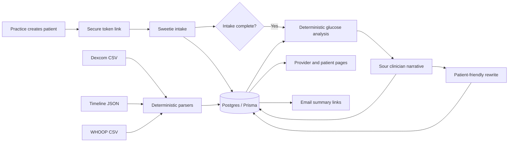

# How the Sweet Spot agents work

Sweet Spot uses two focused AI agents around one diabetes visit:

- **Sweetie 🍬** interviews the patient before the visit and collects optional Dexcom, Google Maps Timeline, and WHOOP exports.
- **Sour 🍋** turns the collected story and data into a concise brief for the clinician and a plain-language summary for the patient.

The model does not control the application or calculate clinical metrics. TypeScript code owns routing, state, parsing, calculations, safety checks, persistence, and notifications; the model is used only for extracting meaning and writing concise language.

## End-to-end flow



## One model gateway

All model calls go through `lib/llm.ts`. It creates one OpenAI SDK client, points it at Amazon Bedrock's OpenAI-compatible Responses API, and reads the model from the environment.

```ts
const client = new OpenAI({
  baseURL: process.env.OPENAI_BASE_URL,
  apiKey: process.env.OPENAI_API_KEY,
});

const response = await client.responses.create({
  model: process.env.BEDROCK_OPENAI_MODEL_ID!,
  input: [
    { role: "developer", content: systemPrompt },
    { role: "user", content: userPrompt },
  ],
  reasoning: { effort: "medium" },
  text: { verbosity: "low" },
});
```

For JSON tasks, `ask<T>(..., { json: true })` asks for one JSON object, parses it, and retries once if parsing fails. If no API key is configured, it throws `LLMUnavailable`, allowing the demo to use deterministic fallback text.

### Timeout, retry, and the circuit (design §3.5, §6.3, §11.3)

Every call is bounded, and no failure reaches a page as a 500:

| Guard | Default | Env |
|---|---|---|
| Timeout per HTTP attempt | 20 s | `LLM_TIMEOUT_MS` |
| Retries | one, transient failures only | — |
| Consecutive failed calls that open the circuit | 3 | `LLM_CIRCUIT_THRESHOLD` |
| How long the circuit stays open | 60 s | `LLM_CIRCUIT_COOLDOWN_MS` |

Transient means a timeout, a dropped connection, 408/409/425/429, or a 5xx. A 401 is not: a bad key fails the
same way twice. The SDK's own retries are off, so this module is the only thing deciding when to try again.

A failure counts once per `ask`, not once per HTTP attempt, so "three failures" is three answers a patient did
not get. When the count reaches the threshold the circuit opens and `ask` throws `LLMUnavailable` without
touching the network; after the cooldown it half-opens and lets one probe through, which either closes it or
re-opens it. A 400 or 422 is this code's bug rather than an outage, so it is rethrown unchanged.

Everything else ends as `LLMUnavailable`, which is the same signal a missing key gives, so each caller's
existing fallback handles it: `scripted()` for Sweetie, placeholder patterns for Sour. `llmStatus()` reports
`{ configured, model, state, degraded }`; `/api/sweetie` passes `agent.degraded` to the page, which shows the
quiet "the assistant is unavailable" note above the question stepper. `e2e/degraded.spec.ts` runs the whole
path against a second server whose gateway is a closed port.

## Sweetie: the patient intake agent

Sweetie is a field-driven state machine rather than an unrestricted chatbot. The patient's visit type and booking reason produce a two-question intake template:

1. Why the patient is coming and what they want from the visit.
2. What has changed and how they have been feeling, adapted to the visit type.

Each field is stored with a confidence level:

```ts
type IntakeFieldState = {
  value: string | null;
  confidence: "unfilled" | "low" | "medium" | "high";
};

type IntakeState = {
  fields: Record<string, IntakeFieldState>;
  skipped: ("dexcom" | "timeline" | "whoop")[];
  flagged: string | null;
  turns: number;
  wrapped: boolean;
  questionsSkipped?: boolean;
};
```

### What happens after a patient message

`POST /api/sweetie` processes each message in a controlled sequence:

1. Save the patient's message.
2. Run a deterministic red-flag scan before sending anything to the model.
3. Ask the model to extract facts into the current intake fields.
4. Merge those facts without lowering existing confidence.
5. Apply a deterministic backstop when the model misses a substantive answer.
6. Select the next incomplete field or finish the intake.
7. Ask the model to acknowledge the answer and ask one short next question.
8. Save the structured intake and provider-readable notes.

The core orchestration looks like this (simplified from the route):

```ts
const flag = scanRedFlags(message);
if (flag) {
  state = { ...state, flagged: flag, wrapped: true };
  const reply = redFlagReply(firstName, patient.provider.name);
  return finish(patient.id, state, fieldDefinitions, visit, reply);
}

const extraction = await extract(
  state,
  fieldDefinitions,
  transcript,
  message,
  lastAskedFieldId,
);

state = merge(state, extraction);
state = backstop(state, lastAskedFieldId, message);

const target = nextTarget(state, fieldDefinitions);
const reply = await speak({
  state,
  target,
  transcript,
  status: patientDataStatus,
});
```

### Deterministic safety comes first

Red-flag phrases such as loss of consciousness, possible diabetic ketoacidosis, severe hypoglycemia, breathing problems, or self-harm are checked with explicit code before the model sees the message.

```ts
export function scanRedFlags(text: string): string | null {
  for (const flag of RED_FLAGS) {
    if (flag.patterns.test(text)) return flag.id;
  }
  return null;
}
```

If a flag matches, Sweetie stops the interview, directs the patient to immediate human help, records the flag for the care team, and does not ask the model to make a medical judgment. Sweetie never diagnoses, interprets glucose values, or recommends treatment.

### Structured extraction

The extraction prompt gives the model the field definitions, current values, previous transcript, and latest patient message. It requests a small JSON object rather than free-form clinical notes:

```json
{
  "fields": [
    {
      "id": "purpose",
      "value": "Wants to discuss recurring afternoon lows",
      "confidence": "high"
    }
  ],
  "declines": ["whoop"],
  "asks_export_help": null
}
```

The application validates field IDs, trims values, records declined uploads, and decides what to ask next. A field is considered answered when its confidence reaches `medium`.

### Upload events

Uploads go to `POST /api/upload`, where code parses and stores the file. After a successful upload, the page sends Sweetie a separate event so she can acknowledge it naturally:

```ts
await fetch("/api/sweetie", {
  method: "POST",
  headers: { "Content-Type": "application/json" },
  body: JSON.stringify({
    token,
    event: {
      type: "upload",
      kind: "dexcom",
      count: 2016,
      days: 7,
    },
  }),
});
```

Data sharing is optional. Patients can decline a source, remove an uploaded source, or skip the remaining questions.

### Voice and text use the same agent

Browser speech recognition converts speech to text, and browser speech synthesis reads Sweetie's response aloud. Voice and typed messages both call the same `/api/sweetie` route, so they share one transcript and one intake state.

## Sour: the clinician summary agent

Sour starts after Sweetie wraps up when Dexcom data is available, or when the clinician explicitly generates a summary. Its pipeline is deliberately split into deterministic analysis and model-written narrative.

### Code calculates the clinical data

Before calling the model, the application calculates:

- Time in, below, and above range.
- Average glucose and GMI.
- Per-day and time-of-day statistics.
- Spikes of at least 50 mg/dL reaching above 180 mg/dL.
- Temporal matches between spikes and nearby visits.
- Sleep averages and possible timing relationships.
- Explicit safety flags for severe lows, excessive time below range, and sustained readings above 250 mg/dL.

For example, spike-to-place matching is deterministic:

```ts
const overlaps = visitStart <= spikePeak && visitEnd >= spikeStart;
const endedJustBefore =
  visitEnd <= spikeStart &&
  spikeStart - visitEnd <= 30 * 60 * 1000;

if (overlaps || endedJustBefore) {
  matchedVisit = visit;
}
```

This produces a compact local-time brief such as:

```text
OVERALL (7 days, 2016 readings): TIR 82% · below 70: 2% · above 180: 16%

BY TIME OF DAY:
  overnight 00-06 | 96% | 118
  evening 18-24   | 68% | 164

SPIKES:
  Tue Sep 22 | 7:40 PM→8:25 PM | 128→214 | after leaving Chipotle at 7:32 PM
```

### The model identifies patterns and questions

Sour receives the precomputed brief and returns only narrative fields:

```json
{
  "patterns": [
    "Three of four evening spikes followed leaving a restaurant; Tuesday had the longest excursion."
  ],
  "questions": [
    "What did you eat and how did you dose before the Tuesday evening excursion?"
  ]
}
```

The prompt requires Sour to cite supplied evidence, avoid causal claims about locations, and never diagnose or recommend medication changes. Numeric values and safety flags remain code-generated even if the model output is incomplete.

### Save, rewrite, and notify

`runSour()` coordinates the complete operation (simplified):

```ts
const clinicianNarrative = await ask<Narrative>(
  sourSystem(),
  deterministicBrief,
  { json: true },
);

const providerSummary = {
  ...computedSummary,
  patterns: clinicianNarrative.patterns.slice(0, 3),
  questions: clinicianNarrative.questions.slice(0, 3),
  flags: deterministicFlags,
};

const patientNarrative = await ask<Narrative>(
  patientSummarySystem(),
  JSON.stringify(providerSummary),
  { json: true, effort: "low" },
);

await saveBothSummaries(providerSummary, patientNarrative);
await sendSummaryLinks();
```

The patient rewrite uses simpler language and excludes clinician-only safety flags. Notifications contain links to the saved summaries rather than patient data in the email body.

## Why this architecture is useful

The agents handle language tasks while ordinary application code handles decisions that must be reproducible. This makes the demo easier to debug, keeps clinical calculations consistent, supports an offline scripted mode, and reduces the chance that a model invents data or changes the workflow.

## Main implementation files

| File | Responsibility |
|---|---|
| `lib/llm.ts` | Shared Bedrock Responses API client, timeout, retry, circuit, JSON retry |
| `lib/visits.ts` | Visit types and their labels: the client-safe half of Sweetie's vocabulary |
| `lib/sweetie.ts` | Intake templates, safety scan, extraction, state transitions, and speech |
| `app/api/sweetie/route.ts` | Sweetie request orchestration and persistence |
| `app/api/upload/route.ts` | Upload validation, parsing, storage, and removal |
| `lib/glucose.ts` | Glucose parsing, time in range, averages, and spike detection |
| `lib/match.ts` | Temporal matching between spikes and visits |
| `lib/sour.ts` | Deterministic provider brief and safety flags |
| `lib/prompts.ts` | Sour clinician, chat, and patient-rewrite prompts |
| `lib/sourRun.ts` | Summary generation, persistence, and notifications |
| `app/api/sour/route.ts` | Sour generation and clinician follow-up API |
